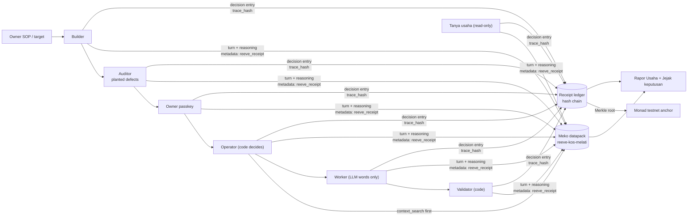

# Reeve

**Your operations, run on your behalf.** Reeve turns a business SOP written in plain language into code that runs on its own, and a separate Auditor proves that code before any money moves.

- **Builder**: SOP → rule cards (LLM) → Python rules + its own tests (deterministic compiler)
- **Auditor**: independent spec from the rulebook, mutation testing, constraint checks → verdict
- **Owner**: approves with a passkey (web app, next slice)
- **Proof**: every run leaves a receipt; Merkle roots go into an append-only, hash-chained ledger

Architecture: [docs/ARCHITECTURE.md](docs/ARCHITECTURE.md). Design notes live in the private reeve-vault repo.

## Reeve on Meko (ContextCon 2027, challenge 07 "Show Your Work")

Reeve's agents now do work, not only watch: they fill a vacant room, run daily content, answer prospects and explain their own decisions. Every turn is a [Meko](https://mekodata.ai) trace with its reasoning, and every trace is bound to Reeve's hash-chained receipt ledger, so **Meko tells you why, and Reeve proves it was not rewritten.**

> **What existed before 7 Nov 2026.** The Builder, the Auditor with planted defects, the Operator (broker), the payment rails, the receipt ledger, the Monad testnet anchor and the web studio were built before ContextCon, for earlier hackathons (this repo was imported on 20 Oct 2026). Everything Meko-related is new and lives on branch `feat/meko-active-crew`, in dated commits from 21 Nov 2026: `packages/meko`, `packages/crew`, `apps/api/src/meko.ts`, `apps/cli/src/crew-demo.ts`, the `decision` ledger entry and the `?view=jejak` page in reeve-web.



| Meko feature | How Reeve uses it |
|---|---|
| Datapack | One per workspace: `reeve-<workspace>` (`reeve-kos-melati`). |
| Conversations + `reasoning` | One conversation per agent per run (Builder, Auditor, owner, Operator, Worker, Validator, Ask), tied by `run_id`, each agent in its own session. Every decision has `reasoning`, so Meko shows a Decision trace card. |
| `context_search` | The Operator searches before it acts: owner exceptions before a late fee, a prospect's history before a reply, past content results before a plan. The hits are hashed into the decision. |
| Memory + `memory_promote` | Owner exceptions ("Kamar 3 boleh telat sampai 10 hari"), prospect histories (pseudonymised), content results, autonomy changes. Promoted memories are shared by every agent. |
| Learning | Playbook C reads which hook brought the most chats from shared memory and picks the next post's hook from it. |
| Artifacts (SHA-256) | Audit reports, contract drafts, the Rapor Usaha. |
| `track_token_usage` | Called for every Worker LLM call when the server offers it (Meko Cloud); on local Meko the usage stays in the message metadata. |
| Decision tracing | `GET /api/meko/public/decisions/:receipt` and `?view=jejak` rebuild one decision with its chain, what it looked up, and the proof. |

**Tamper-evident traces.** For each turn Reeve hashes exactly what Meko stores (`input`, `output`, `reasoning`, `plan`, and the ids of what `context_search` returned) and appends a `decision` entry with that `trace_hash` to the hash-chained ledger. The entry's hash is the receipt, written back into the Meko message as `metadata.reeve_receipt`. `verifyDecision` re-reads the message from Meko, recomputes the hash, checks the chain and the Merkle proof against the first anchor after it. Edit the reasoning in Meko, or a ledger line, and the check names which one changed.

**What the crew does on Kos Melati** (synthetic 30-room kos, pseudonymised):

- **Playbook B, "kamar kosong terisi sendiri"**: vacancy, listing drafted by the Worker and checked by the Validator, owner review, publish, CS on whitelisted intents only (escalations win), viewing booked, Rp500.000 deposit on the test-mode rail within the approved bound, contract draft, owner passkey. It stops itself at its target.
- **Playbook C, content loop**: plan from business truth (room vacant longest, paydays, campus calendar), script and caption, Validator, owner review, publish, measure (simulated), learn.
- **Auditor for playbooks**: worst-case budget math, review on every publish or payment, a stop condition, reachability of every step, and planted violations plus bad drafts that must all be caught.
- **Earned autonomy** per action class (`ask`, `ask_if_unusual`, `auto_digest`, `auto`), promoted only on clean receipts with the owner's passkey, demoted on any override, complaint or 10-minute undo.
- **Tanya usaha**: a read-only agent that answers "kenapa saya didenda?" from the trace, with a link to the proof.
- **One payment-plan bound**: "maksimal 2 cicilan, lunas sebelum tanggal 25", audited with planted bad offers; offers inside it cite it, the rest go to the owner.
- **Rapor Usaha**: the audit report generated from traces and receipts, stored in Meko as an artifact.
- **SOP Discovery** (`?view=temukan`, signed in):
  - Input: a WhatsApp chat export and the payments sheet (CSV or Excel). Names become `K01`… first.
  - Code mines rulebook cards. Each card has a confidence and the chat or payment line it came from. No LLM sees the history.
  - The Auditor replays every past bill against the cards and shows where they differ from what the owner did.
  - The owner taps Ya/Tidak on each card. Each tap is a trace plus a receipt.
  - Confirmed cards go through the normal audit with planted defects. Fewer than 3 confirmed keeps Reeve in "mode belajar": it watches and suggests only.
- **Telegram tenants**:
  - A one-time code links a tenant's chat. Only an HMAC of the chat id is kept.
  - "Kenapa saya didenda?" is answered from the trace with a "lihat bukti" link. The answer is a traced decision too.
  - WhatsApp stays a `wa.me` link the owner sends by hand.
- **Rapor share links** (`?view=rapor&share=`):
  - Metrics only. Revocable; whether a link is live is read from the ledger.
  - The page recomputes every ledger hash and anchor Merkle root in the browser.

### Run it

```bash
export MEKO_CONTEXT_ENGINE_DIR=$HOME/.local/share/meko/app/current/context_engine
export MEKO_WEB_UI_DIR=$HOME/.local/share/meko/app/current/web_ui/dist
meko start
```

```bash
npm run crew:demo -- --fresh
```

Meko Cloud: `npm run meko:seed` (needs `MEKO_API_KEY`; `--local` rehearses on local Meko; `--ledger=pg` writes the ledger where the deployed API reads it).

```bash
npm run dev
```

Then open the web app at `/?view=jejak` (no sign-in needed) and the report at `/api/meko/public/report.html`. Add `--llm` to let Claude Haiku 5.5 word the drafts (needs `ANTHROPIC_API_KEY`). For Meko Cloud set `MEKO_API_KEY` (and optionally `MEKO_MCP_URL`) in `.env`; without it the local Meko and `meko token` are used. `REEVE_MEKO_PUBLIC_ASK=on` opens `POST /api/meko/public/ask`.

### Measured on Kos Melati (local Meko 1.20261116.0, 21 Nov 2026, `crew:demo --llm`)

| | |
|---|---|
| Traced decisions in Meko | 79, all verified against their receipts |
| SOP audit | 61/61 planted defects caught, 11 spec cases (local sandbox) |
| Playbook audits | B: 19/19 planted violations and 12/12 bad drafts caught; C: 13/13 and 12/12 |
| LLM calls | 6 Worker drafts (Claude Haiku 5.5), 1,605 input + 2,813 output tokens, every draft passed the Validator |
| Model calls | 6 of 79 turns, all wording drafts; no model call decides whether to act |
| `context_search` | 26 searches before acting |

Limits, said plainly: content metrics are simulated; connectors run on the Log connector (recorded, not sent) until Instagram, WhatsApp and Calendar are connected; the seed marks the owner's passkey as `demo` (the API's real passkey flow is unchanged); `track_token_usage` needs Meko Cloud; SOP documents are not yet uploaded to the Meko knowledge base.

### Gotong Royong: shared learning across businesses (`npm run gotong:demo`)

Businesses that consent pool what their first drafts taught the Builder, as anonymous aggregate patterns in one project-level datapack (`reeve-gotong-royong`). A new business's Builder reads the pool before it drafts.

- **Consent.** `consentShare` is an owner decision (`consent_share_patterns`) with a receipt, per kind of pattern, revocable. A business that has not consented contributes nothing (`withheld`).
- **Patterns.** `extractPatterns` derives them from real pipeline runs (Builder, Auditor, sandbox) of each business's first drafts: planted-defect kinds planted and surviving, and why first drafts were rejected. An aggregate behind fewer than 2 businesses is dropped. Dropped on purpose, and reported: content hooks (only Kos Melati runs content and its reach numbers are simulated, so k = 1) and reminder times (the crew records the day of a reminder, not its time).
- **Publish.** `publish` writes each pattern as promoted memory with a receipt that holds counts, kinds and consent-receipt hashes only. A leak check refuses any business name, alias, amount, phone or id. All of this is plain code; no model decides whether to share.
- **Read.** `readForNewBusiness` runs `context_search` on the pool and returns short hint sentences (composed by code from the counts). `parseSop(..., { sharedHints })` adds them to the Builder's prompt as an advisory block; with no hints the prompt is byte-for-byte unchanged. The Builder's compile step stays deterministic, so the only place hints can matter is the model's rule cards (the first draft).

Measured on a new business, "laundry kiloan" (a SOP of 6 rules incl. an owner-approval limit, 12 records; `apps/cli/fixtures/laundry-kiloan`). Claude Haiku 5.5, local Meko, 12 runs per arm, interleaved, first attempt only (no repair loop), 22 Nov 2026:

| | without hints | with hints |
|---|---|---|
| First draft passed the Auditor | 4 of 12 | 12 of 12 |
| Blockers per draft (mean / median / min / max) | 0.67 / 1 / 0 / 1 | 0 / 0 / 0 / 0 |
| Planted-defect survivors on the first attempt (mean / median / min / max) | 0 / 0 / 0 / 0 | 0 / 0 / 0 / 0 |
| Input tokens per run (mean / median / min / max) | 3,934 / 3,934 / 3,934 / 3,934 | 4,136 / 4,136 / 4,136 / 4,136 |
| Output tokens per run (mean / median / min / max) | 4,869 / 4,865 / 4,299 / 5,420 | 4,856 / 4,769 / 4,346 / 5,603 |
| Cost per run | $0.0028 | $0.0028 |

What it shows. The 8 failures without hints are the same blocker: an approval-limit card with no rule naming the amount field (`RULEBOOK_INVALID`, rejected before anything runs). The pool held exactly that pattern (1 of 9 first drafts across 3 businesses), the hint states it, and with it 12 of 12 drafts passed. The hint costs 202 input tokens and no extra output. On planted-defect survivors the result is null: no first draft in either arm, and none of the 9 first drafts in the pool, left a planted defect alive, because the Auditor derives its spec from the cards. So "defect kinds that usually survive" has no data to teach and the claim is not made.

What it does not prove. One new business, one SOP, one model, N = 12 per arm, 24 calls (plus a 2-call pilot, 26 of the 30-call cap, about US$0.07). The failure the hint prevents was seen in one of the pool's own drafts (a Haiku draft of the Bimbel SOP) and the laundry SOP has the same kind of approval rule, so this is the best case for a hint, not a typical one. The pool is built from saved first drafts of three businesses and three models, not from a long-running fleet. The hint text is a template filled by code, not learned wording. The fixture mode (`npm run gotong:demo`, the default) returns the same rulebook in both arms: it is deterministic, proves the wiring (hints reach the prompt, 589 more characters) and the consent, k >= 2 and leak checks, and shows no effect by design. In the demo all workspaces share one ledger file; in production each business keeps its own, and only the pool's workspace is shared.

`npm run gotong:demo -- --fake` runs on in-memory Meko; `--runs=N` sets runs per arm; `--llm` uses Haiku (needs `ANTHROPIC_API_KEY`; refuses more than 30 LLM calls and stops if one run costs over US$0.05). Results go to `.reeve/gotong/results-*.json`.

### Token efficiency: code decides vs LLM in the loop (`npm run bench:tokens`)

The same Kos Melati months run two ways. Both arms get the same 49 decision events (the 36 bills of `kosDiscoverySample()`, each checked on H+3, H+7, H+10 and H+14 while still unpaid, or on the day paid when that is before H+3). Ground truth is what the approved rule cards decide (`decideRent`, the logic of `rentTick`, incl. the 12-month grace, once-per-bill fee and the planted exception: K03 in September has the owner's permission to be late, so its fee is held). Mix: 28 none, 13 remind, 5 charge_fee Rp75.000, 2 hold, 1 notice.

- **LLM in the loop.** Per event one call: the full SOP, the whole pseudonymised chat and payments history up to that day, and the bill; strict JSON back (`remind | charge_fee + amount | hold | escalate | none`) plus the message to send.
- **Reeve.** The SOP is compiled once by the Builder (Haiku). Each decision is made by `rentTick` (code, with a Meko `context_search` for the owner's exceptions). The model only words the message for remind, fee and notice, from the facts plus the 3 best Meko chunks (the `Worker` prompt of `packages/crew`).

Claude Haiku 5.5, local Meko, 10 runs per arm, interleaved, 22 Nov 2026. Per run, mean / median / min / max:

| arm | LLM calls | input tok | output tok | cost (USD) | accuracy vs rules |
|---|---|---|---|---|---|
| LLM in the loop | 49 | 105,407 (constant) | 13,345 / 13,290 / 12,367 / 14,316 | 0.0172 / 0.0172 / 0.0167 / 0.0177 | 93.1% / 92.9% / 89.8% / 95.9% |
| Reeve | 19 | 5,677 (constant) | 9,298 / 9,174 / 8,717 / 10,080 | 0.0052 / 0.0052 / 0.0049 / 0.0056 | 100% (all 10 runs) |
| ratio (means) | 2.6x | 18.6x | 1.4x | 3.3x | |

Calls, input tokens and (for Reeve) accuracy do not vary between runs, so their four statistics are the same number. Wall time per run: 93 to 102 s baseline, 54 to 62 s Reeve (sequential calls, local Meko).

Where the baseline is wrong: fee decisions 72% (36 of 50 across runs), the planted exception 75% (15 of 20), plain "none" 94.6% (265 of 280), reminders and notices 100%; 15 of its 490 replies were not valid JSON with a known action and count as wrong. Reeve had no wrong decision, but that is partly by construction: its decisions run the same logic as the ground truth. What it does test is that Meko finds the owner's exception (20 of 20 holds).

Compile, paid once: 2,844 input + 3,211 output tokens, US$0.0019 (mean of 3 Builder calls, none failed; in an aborted earlier run one draft failed conversion, a card missing a field, which the script now retries and counts). Extrapolated from the measured month, not measured: with the compile paid once, Reeve costs US$0.0071 for 1 month (2.4x cheaper), US$0.0175 for 3 months (2.9x) and US$0.0645 for 12 months (3.2x) against US$0.0172, US$0.0516 and US$0.2066 for the baseline; input tokens 8.5k / 19.9k / 71.0k against 105k / 316k / 1,265k.

What it does not prove. One business, one SOP, one model, 10 runs, 49 events. The saving is large on input tokens (18.6x) and small on cost (3.3x): Haiku 5.5 spends most of its billed output on reasoning before it answers, and the Reeve Worker's wording call is billed the same way, so output tokens fall only 1.4x and output dominates the Reeve bill. The baseline's accuracy (93%) is good; the gap is on fees and the exception, not on routine reminders. The baseline got every advantage we could give it: no prompt caching on either side (a cached SOP and history prefix would cut the baseline input cost), history cut to what was known before each day, the same message wording task, the same model, parameters (SDK default temperature, max 1,200 output tokens) and sequential calls. A smarter baseline (retrieval instead of the whole history) would sit between the two arms; it was not run. Not counted: Meko's own cost (local here), the one-time Auditor/sandbox run, the owner's approval, and the Validator. Reeve's compiled rulebook is not what executes in this benchmark: decisions run the approved fixture cards in `rentTick`, so whether a Haiku compile reproduces them is a separate question (the Auditor's job). Cost uses the price table in `packages/llm` (Haiku 5.5, US$0.10 in and US$0.50 out per million tokens, standard tier). Total spend for the real run: about US$0.23 of a US$2.50 cap.

Rerun: `npm run bench:tokens -- --fake` is an offline deterministic stub with a fake counter (4 characters per token; labelled "FAKE", not a measurement). Real: start local Meko (`meko start`), then `npm run bench:tokens -- --llm --runs=10` (needs `ANTHROPIC_API_KEY` in `.env`; `--fake-meko` for in-memory Meko; `--compiles=N`). It stops if the first baseline run costs over US$0.30 or the estimate passes US$2.50. Results: `.reeve/bench/tokens-*.json` (gitignored). The scoring and aggregation are covered by `apps/cli/test/token-bench.test.ts`.

### Beli bareng (group buying, `npm run groupbuy:demo`)

Three minimarkets (pseudonymised M1 to M3) buy from one supplier (S1). Code batches their purchase orders per sku, prices every line at the supplier's volume tier and works out each owner's total and saving against buying alone. No model decides anything. Each owner consents first (`consent_group_buy`) and approves only their own line (`approve_group_line`, in their own workspace; the decision holds none of the others' quantities). A refusal drops that line and the batch is recomputed, so a tier can drop. After at least 2 approvals the batched order is placed as `place_group_order` in the shared workspace (receipt hashes and per-sku totals, no business names) through the Log connector. `verifyGroupOrder()` re-reads every receipt and checks the approved lines add up to the order; an edited line fails it.

Run it: start local Meko (`meko start`, see above), then `npm run groupbuy:demo` (`-- --fake` for in-memory Meko). It prints three scenarios (all agree, one refuses, one has not consented) with qty, line total, saving and receipt prefix per business.

Limits: the POs are a small fixture, not real orders; the supplier tiers (5% from 50 units, 8% from 100 per sku) are assumptions, not a real price list; nothing is sent to a supplier and no money moves.

### Pembelajaran mandiri (self-learning)

The loop: the owner keeps granting the same exception ("kamar 3 boleh telat sampai 15 hari", three times) -> Reeve notices the pattern -> the Builder proposes an SOP amendment as a plain Indonesian diff -> the Auditor runs the full audit on the amended rulebook (spec cases and planted defects) -> only if every planted defect is caught is it offered -> the owner approves or rejects -> the improvement is shown from a replay of the history. Nothing changes until the owner approves, and approving saves a rulebook version and sends nothing.

What runs locally (all of it, no Meko Cloud needed): `packages/crew/src/amend.ts`. `recordException` stores each exception as promoted Meko memory (tagged with rule id and a reason class, e.g. `late_grace:15`, days rounded up to 5) plus an `owner_exception` decision with a receipt. `localShortfalls` clusters by rule and class and counts distinct (tenant, month) pairs; 3 or more is a shortfall (`SHORTFALL_MIN`). `proposeAmendment` changes the rulebook in code (late fee start day only, today), traces `amend_propose` (Builder) and `amend_audit` (Auditor), and the owner's `amend_approve` / `amend_reject` carry a session-confirmation proof, like the autonomy ladder. `verifyImprovement` replays the history under the old and the amended rule and counts the bills that needed an owner exception (demo: 3 of 24 become 0, no other bill changes), and counts `context_search` hits on the exception text before, and again after approval (new exceptions since). If there is no history it says so instead of claiming anything; if the replay does not improve, the page says "belum terbukti".

Cloud only, unverified: Meko Cloud may offer `selflearning_shortfalls` and `selflearning_verify`. Local Meko 1.20261116 has no such tools (40 tools, none match, no flag). `MekoSelfLearning` feature-detects them; with `REEVE_SELFLEARNING=cloud` and the tool present it calls `selflearning_shortfalls` with best-effort arguments (their schema is not known) and uses the answer only when it names a rule that has a local cluster; on a missing tool, an error or an unknown shape it falls back to the local code and records which path ran in the amendment (`path`, `path_note`). `selflearning_verify` is called as an extra and its answer is never used to claim an improvement. The Cloud path has never been run against real Cloud.

Flags. `REEVE_SOP_AMENDMENTS=on` (off by default) enables `GET /api/meko/owner/amendments`, `POST .../amendments/scan`, `.../amendments/:id/approve` and `.../reject`; with it off the list is empty (`enabled:false`) and the other routes answer 409. `REEVE_SELFLEARNING=cloud` asks Cloud first. `npm run crew:demo -- --amend` seeds four exceptions (three of the 15-day kind, one 10-day kind that stays below the threshold) and one pending amendment (run the API with the flag on).

Limits: one kind of change (a later late-fee day) is automated; other exception reasons are counted but not turned into a rule change. The improvement is measured on the demo's synthetic three-month history, which was written so the owner follows the SOP except for those exceptions; on real history the replay may well show other differences, and the page shows them. The audit proves the amended rules are internally consistent, not that the new tolerance is a good business decision. In the amended demo rulebook the notice (H+14) comes before the fee (H+15); the diff says so.

### Ketenangan pemilik (calm for the owner)

Two things so the owner is not pinged all day. Digest: one message per day, built by code from ledger facts (no LLM): what ran by itself per class, what is staged and can still be undone, how many drafts wait, amendment proposals pending, ledger intact yes/no, a link to `/?view=kendali`. Counts and pseudonymous facts only, never a tenant name. `sendDigest` records one `send_digest` decision per day (output `{date, hash, channel, delivered}`); a second call the same day returns the first receipt and sends nothing. Undo window, done truthfully: an auto-run action is not executed at once. `Outbox.stage` writes it to `meko_outbox` with `due_at = now + 10 min` (decision `auto_stage`); `flush` runs it once through the injected connector after that (decision `auto_run`, the clean evidence for the ladder); `undo` before `due_at` cancels it so it never runs, records an `undo` receipt that links the staged one, and drops the class one level. After the window undo is refused ("Sudah terkirim, tidak bisa dibatalkan"). In the demo the connector is the Log connector, so nothing is really sent; `crew:demo` leaves two reminders past the window and two inside it.

Routes (session-guarded): `GET /api/meko/owner/outbox`, `POST .../outbox/:id/undo`, `GET .../digest` (text, a `wa.me` link the owner opens and sends themselves, channel status), `POST .../digest/send`. The page is Kendali ("Ringkasan hari ini", "Jalan sendiri, bisa dibatalkan"). The owner can bind their own Telegram chat (`POST .../telegram/owner-link`, code subject `PEMILIK`; tenant links stay `K05`-style) and send `/ringkasan`: the digest comes back as the webhook reply, so no bot token is needed.

What is dry-run: `/digest/send` returns the text and sends nothing. A real Telegram push needs all of `TELEGRAM_BOT_TOKEN`, `REEVE_DIGEST=on` and `TELEGRAM_OWNER_CHAT_ID`; any one missing means dry run. That live path is unit-tested with an injected fetch only and has never been run against Telegram. The API flushes the outbox when the owner page or the digest is read, not on a timer, so a due item runs on the next read.

## Quick start

Requires Node ≥ 20 and Python ≥ 3.9.

```bash
npm install
```

```bash
npm run demo
```

```bash
npm run demo:bug
```

Live (reads `.env`): `npm run demo:createos` runs the job in a real CreateOS microVM; `npm run demo:live` also parses the SOP with Claude; `npm run check:egress` proves the sandbox cannot reach the internet.

`demo` runs the Kos Melati SOP (30 rooms, 45 simulated days) end to end. `demo:bug` makes the Builder misread the tenure-grace rule; the Builder's own tests still pass, the Auditor catches it, and the revised code passes.

Default mode is fully offline: `REEVE_LLM=fixture` (pre-recorded rule cards) and `REEVE_SANDBOX=local` (subprocess, **dev only, no isolation**).

| Variable | Values | Effect |
|---|---|---|
| `REEVE_LLM` | `fixture` · `anthropic` · `anthropic:claude-haiku-5-5` · `openrouter` · `gemini` · `groq` · `deepseek` · `openai` · `ollama` · `custom` | The default SOP parser. Every parser that is set up stays selectable per SOP in the studio. See "Choosing the model" below |
| `REEVE_MODEL` | Claude model id | With `REEVE_LLM=anthropic`: `claude-opus-5-5` (default), `claude-sonnet-5-5` or `claude-haiku-5-5` |
| `REEVE_SANDBOX` | `local` · `createos` | `createos` runs every job in a CreateOS microVM (`CREATEOS_API_KEY`), egress locked, destroyed after the job |
| `REEVE_HOME` | path | Where runs, receipts and `ledger.jsonl` are written (default `.reeve/`) |

Flags override env: `--llm=anthropic:claude-haiku-5-5`, `--sandbox=createos`, `--pack=minimarket`, `--sop=path/to/sop.md`.

### Choosing the model

The model only turns the SOP into rule cards; the Builder's code and the Auditor's checks are the same whichever model reads it, and a card that does not fit the schema is rejected before anything runs. So an owner on a small budget can pick a cheaper or free model:

| Parser | Set up in `.env` | Price |
|---|---|---|
| Claude Opus 5.5 / Sonnet 5.5 / Haiku 5.5 | `ANTHROPIC_API_KEY` | $4/$20 · $2/$10 · $0.10/$0.50 per M tokens |
| OpenRouter, Google Gemini, Groq, DeepSeek, OpenAI | `<NAME>_API_KEY` and `<NAME>_MODEL` (e.g. `GROQ_API_KEY`, `GROQ_MODEL`), model id exactly as the service lists it | The service's price; several have free tiers |
| Ollama on this computer | `OLLAMA_MODEL` (and `OLLAMA_BASE_URL` if not `localhost:11434`) | Free; the SOP never leaves the machine |
| Any other OpenAI-compatible server (LM Studio, Together, vLLM, ...) | `REEVE_OPENAI_BASE_URL`, `REEVE_OPENAI_MODEL`, optional `REEVE_OPENAI_API_KEY` | Depends |
| Sample rulebook (`fixture`) | nothing | Free; replays the hand-written cards and ignores the SOP text |

Claude goes through the official SDK with structured outputs. The others use the OpenAI chat-completions protocol: strict JSON Schema first, plain JSON mode if the server rejects it (DeepSeek starts there), one repair turn if the reply does not fit, then a clear error. Keys stay on the server; `GET /api/providers` lists only which parsers are set up.

## Dashboard (API + web)

```bash
npm run dev -w @reeve/api
```

```bash
npm run dev -w @reeve/web
```

On a phone the studio folds into one step at a time:
- A compact header.
- A sticky progress bar: Describe → Rules → Audit → Approve → Run → Proof.
- Every other step as a numbered row with a one-line summary; tap one to open it.
- The next action docked at the bottom.

On wider screens every step stays open, with the same progress bar and a "Next" banner.

Open http://localhost:5173. Compile the SOP, run **Simulate & audit** (watch the sandbox in the glass box), register the owner passkey, then **Approve with passkey**: the WebAuthn challenge is bound to the run's receipt hash and the approval lands on the ledger.

### Run on a payment rail (Stripe or Xendit, test mode)

After approval, **06 · Run** bills the tenants for real on a payment rail. Reeve keeps a business clock that starts on the cycle the Auditor simulated (1 Nov). Each step runs the approved `rules.py`, unchanged and hash-checked against the receipt, in the sandbox over the payments the rail has confirmed. The broker (`packages/broker`) then turns only the new events into rail calls:

- **Invoice:** a bill on the rail with a hosted payment page.
- **Late fee:** a separate bill.
- **Bill, late fee, reminder, notice:** sent to the tenant through the connector registry, Telegram first, else Gmail, else logged (see "The Operator in practice" below). A bill message carries the payment link.
- **Overpayment:** an exception. Keeping it as credit needs no approval; a refund above the rulebook's limit needs the owner's passkey.

If the rules break a constraint, nothing is sent. Every step goes on the ledger.

| Rail | Set up in `.env` | What it uses |
|---|---|---|
| Stripe | `STRIPE_SECRET_KEY` (`sk_test_…`); optional `STRIPE_WEBHOOK_SECRET` from `stripe listen --forward-to localhost:8787/api/webhooks/stripe` | Invoicing: a finalised `send_invoice` invoice with a hosted invoice page; IDR in minor units (×100). **Pay (test)** uses the test card |
| Xendit | `XENDIT_SECRET_KEY` (`xnd_development_…`); optional `XENDIT_WEBHOOK_TOKEN` (Dashboard → Webhooks, URL `…/api/webhooks/xendit`) | Payment Sessions (the successor of the Invoice API): a PAY session with a hosted link for VA, QRIS and e-wallets. Pay on the link in test mode; **Pay (test)** then settles the payment request you started |
| Offline | nothing | In-memory bills, for demos without a key |

Live keys are refused. Without a webhook secret, **Check payments** polls the rail. `npm run rails:smoke -- --rail=stripe` (or `xendit`) creates one Rp10.000 bill, pays it and refunds half, to check a key before a demo. `npm run preview:seed` builds a separate store in `.reeve/preview` with a simulated approval, for trying the Run panel without a passkey (`reeve-api-preview` in `.claude/launch.json`).

### The Operator in practice (11 Nov 2026)

- **Scheduler.** Off by default. `REEVE_SCHEDULER=on` advances every running operation by itself, one business day per `REEVE_SCHEDULER_DAY_SECONDS` (default 86400; set 30 for a demo: a day passes every 30 s). `REEVE_SCHEDULER_TICK_MS` is how often it checks. The manual "advance" button still works; `GET /api/scheduler` and each operation's `scheduler` field show where the clock stands. Three failures in a row pause that operation.
- **Messages.** Tenant contacts come from the sheet's `telegram_chat_id` and `email` columns. A message goes to Telegram (`TELEGRAM_SEND_MESSAGE`), else Gmail (`GMAIL_SEND_EMAIL`), else the Log connector. It is only really sent when that connector has a connected account (Composio key plus a connected Telegram or Gmail); otherwise it is logged and the action says "logged". The sample tenants have no contacts, so they always log. Only these tools can be called.
- **Payments as tools.** `XENDIT_CREATE_INVOICE`, `STRIPE_CREATE_INVOICE` and `MOCK_CREATE_INVOICE` exist on the `payments` connector, on the same rails and test keys as the rent pack (live keys refused). A generic rule card can call them; the approval limit and passkey hold apply as for any action. The pay link is stored on the action.
- **Minimarket** runs through the generic Operator: purchase orders become supplier messages (`po_created` sent, `po_approval_request` held for the owner's passkey). Supplier contacts are given when the run starts (`{"suppliers": {"A": {"telegram_chat_id": "…"}}}`); without one the order is logged.
- **LLM in the Operator, off by default.** `REEVE_OPERATOR_LLM=on` plus a provider with a key. It does two things only: rephrases an approved message in Bahasa Indonesia (the draft is thrown away if it loses the amount or the payment link), and reads a tenant's reply into `promise_to_pay`, `already_paid`, `asks_relief` or `unclear`. The rulebook still decides whether, when and to whom; the model never sets amounts, dates of rules or recipients. Cost is bounded: it uses a Haiku-class model by default (`REEVE_OPERATOR_MODEL`, default `anthropic:claude-haiku-5-5`; the default Opus or Sonnet is never used for this), words each message kind once per advance with `{{name}} {{room}} {{amount}} {{link}}` placeholders filled by plain code (30 bills cost a few calls, not 30, and the model never sees a tenant's name or amount), and stops at a call cap per advance. A reply the model cannot read is recorded with its real error (`error` on the reply, `model_error` in the ledger and a server warning), and "No language model is configured" appears only when there truly is none. Without a model, messages use the plain template and every reply goes to the owner.
- **Webhooks bypass the session gate.** `POST /api/webhooks/telegram` and `/api/webhooks/:rail` need no login; each authenticates by its own secret or signature inside the workspace that owns the bill. A message that cannot be sent in the generic or minimarket path is kept on the Log connector, like rent. The scheduler advances each operation independently (never twice at once, new ones picked up on the next tick); only the sandbox itself runs one job at a time.
- **Replies.** `POST /api/operations/:id/replies` `{tenant, text}`, and the Telegram bot webhook `POST /api/webhooks/telegram` (needs `TELEGRAM_WEBHOOK_SECRET`, the same value as the `secret_token` given to Telegram's `setWebhook`; unset means 409). `promise_to_pay` with a date in the next 30 days holds the reminders for that bill until then; `already_paid` asks the rail; `asks_relief`, `unclear`, a bill above the rulebook's approval limit (no limit card means 0) and anything without a model go to the owner (`status: waiting_owner`, `POST …/replies/:rid/resolve` closes it). Nothing is sent back to the tenant automatically. Every reply and action is on the ledger (`reply_received`, `reply_actioned`).
- **Cost meter** (`GET /api/usage`, session-gated; narrow it with `?rulebookId=` or `?operationId=`, pick a month with `?month=2026-11`; `GET /api/rulebooks/:id/usage` is the same for one rulebook). Every model call, Builder or Operator, writes one record (`usage` in the workspace store) from the provider's own `usage` block: Claude `input_tokens` / `output_tokens` plus the cache fields, OpenAI-compatible `prompt_tokens` / `completion_tokens`, the offline sample zero. Each record is tagged with its phase (`builder_compile`, `operator_draft`, `operator_classify`), the rulebook, the operation and the workspace. The USD price is per million tokens, from the Claude API price table (checked 11 Nov 2026): Opus 5.5 $4 / $20, Sonnet 5.5 $2 / $10, Haiku 5.5 $0.10 / $0.50 (a prompt over 100K tokens: $0.50 / $2.50, the whole call), Fable 5.2 $8 / $40; cache writes count 1.25x and reads 0.1x the input price. A model outside that table (Groq, Ollama, ...) keeps its tokens and has **no cost** ("tidak diketahui") unless `REEVE_PRICE_OVERRIDES` names one. Rupiah is USD times `REEVE_USD_IDR` (default 18154, JISDOR BI, 11 Nov 2026; set `REEVE_USD_IDR_DATE` with your own rate); the response always carries the rate and its date. The response also counts the **deterministic steps** the rules and plain code carried out (bills, messages, credits, exceptions; blocked or failed ones are not counted) so the studio can say "42 langkah dijalankan kode, 3 panggilan AI". Months are Jakarta time. Only measured numbers: no estimate, no comparison.
- **WhatsApp click-to-send.** Reeve never sends on WhatsApp. When a tenant sheet has a `whatsapp`, `wa`, `phone`, `no_hp` (and similar) column, and no automatic channel delivered the message (Telegram, then Gmail; none on file, nothing connected, or the send failed), the Operator prepares `https://wa.me/<digits>?text=<message>` instead of the Log fallback and records `message_prepared` (channel `whatsapp_link`) on the ledger. The action says "prepared, not sent". Numbers are normalised for Indonesia (`0812-3456-7890`, `+62 812…`, `0062…`, `812…` all become `62812…`); an unusable number is skipped with its reason and the message is logged as before. The owner opens the link from their own phone, then taps **Tandai terkirim**: `POST /api/operations/:id/messages/:messageId/sent` records `message_sent_by_owner` (the owner's word, not a delivery receipt) and is idempotent (`changed: false` the second time). Prepared messages are on the operation as `prepared`. Held things stay held: a reminder held because the tenant promised to pay prepares nothing, and a minimarket purchase order above the limit gets its link only after the owner approves it. Minimarket suppliers take a `whatsapp` value too (`{"suppliers": {"A": {"whatsapp": "0812…"}}}`).

### Any SOP (generic pack) and connectors

**Any SOP** in the studio runs a business process that no domain pack covers. The rules run over the owner's own records: the Bimbel Cerdas sample (12 students), or an uploaded CSV exported from Google Sheets or Excel. A rule card says: on a schedule, for each record whose conditions hold, run one connector tool. Other cards:

- **Never:** a tool must not run for records that match a condition.
- **Approval limit:** an action above an amount waits for the owner's passkey.
- **KPI:** a sum or count over the records, compared with a threshold.

The model sees only field names, types and short category labels such as `lunas/belum`. It never sees names, phone numbers or emails.

The Builder generates `rules.py` with named thresholds, and `reeve_runtime/generic_engine.py` runs it. The Auditor builds its own boundary cases from the cards: either side of every condition, the schedule, once-per-record, approval limits, never rules and KPI thresholds. Every threshold, operator, schedule and limit is then mutated to check those cases catch the change. At compile time, every tool is checked against the connected services:

| Connector | Set up | For |
|---|---|---|
| Composio | `COMPOSIO_API_KEY`: a project key (`ak_…`, official SDK, `COMPOSIO_USER_ID`) or a Connect consumer key (`ck_…`, Composio's hosted MCP server; Reeve calls its schema, connection-list and execute tools deterministically) | Gmail, Telegram, Sheets, Slack, Shopify, HubSpot, ... |
| Any MCP server | `REEVE_MCP_SERVERS` (JSON list of `{name, url, headers}`) | Systems Composio lacks: Indonesian POS, accounting, marketplaces |
| Log | nothing | Actions are recorded, not sent, until a service is connected |

**Any app, both ways:**
- **Records:** come from any connected app's read tool. The studio has presets for Google Sheets (`GOOGLESHEETS_VALUES_GET`), Notion (`NOTION_QUERY_DATABASE`), ClickUp (`CLICKUP_GET_TASKS`) and Airtable (`AIRTABLE_LIST_RECORDS`), plus any slug with JSON arguments. Reeve flattens whatever comes back into rows: a header row with data rows, or a list of objects with Notion-style properties reduced to plain values. A dataset read from an app is read again on every run step.
- **Actions:** can use any tool. Rules render text, and the broker turns it into the numbers, flags and lists the tool's schema asks for.
- **Build-time correction:** if the model names a tool no connected service has, the API asks Composio's tool search for real tools for that rule, with their required arguments. The model gets one retry with them.
- **Commands:** `npm run connectors:check`, `connectors:read` and `connectors:send` do the same from the terminal.

Verified live on 19 Oct 2026 with Composio Connect and Google Sheets:
- Reeve added a "Reeve test" tab with one row to an existing spreadsheet, leaving the other tabs untouched.
- It created a "Reeve - Bimbel Cerdas (sample)" spreadsheet and filled it with the sample's 12 rows.
- It read that sheet back as a dataset. Opus 5.5 compiled the SOP over its columns, using real tool slugs with every required argument.
- The Auditor passed it: 3/3 Builder tests, 13/13 spec cases, 24/24 planted defects, no violations.

When a run goes live, each step runs the approved `rules.py` over the current records in the sandbox. The broker then calls only the tools the approved rulebook names. Actions above the limit wait for the passkey, and every call goes on the ledger.

`npm run demo:generic` runs the sample end to end. Live results on 19 Oct 2026, from the Bimbel Cerdas SOP:

- **Opus 5.5:** PASS (13/13 spec cases, 24/24 planted defects). Its decisions matched the hand-written rulebook: 23 actions, 7 waiting for approval, 5 blocked, 5 KPI alerts.
- **Haiku 5.5:** blocked, because it left out the amount the Rp2 jt limit applies to, so the limit could never trigger.

The owner app (PWA) shows "Any SOP" rulebooks the same way as the domain packs:
- The tab is named after the data's entity (Siswa, Orders, ...).
- "What Reeve did" is written in the owner's own rule titles.
- Actions held above the limit appear under Approvals. In a live run they can be sent with the fingerprint, or declined.

### Connect your apps

`/?view=apps` lists every app the owner can connect: Composio's catalog of about 1,600 apps, read from `docs.composio.dev/toolkits.md` and cached for a day. Common small-business apps (Gmail, Sheets, Drive, Telegram, Notion, ClickUp, Odoo, ...) come first, and the list is searchable.

**Connect** opens a card with Composio's sign-in link, valid about 10 minutes. The owner signs in with OAuth or pastes the app's API key on Composio's page, so Reeve never sees it. "I've connected it" checks the account is active. API: `GET /api/apps?q=`, `GET /api/apps/status?slugs=`, `POST /api/apps/:slug/connect`.

### Change a rule (Maintain)

On an audited or approved rulebook, **Change a rule** opens the SOP for editing. The chosen model reads the revision into a new version; edited card values also work through `POST /api/rulebooks/:id/revisions` with `{ rulebook }`. The studio then shows:

- **Changes from the approved version:** card by card, ignoring wording (for example, R3 percent: 5 → 8).
- **Impact on the same simulated month,** once the revision passes the audit: totals that move, and which tenants are affected and how (late fees Rp1.275.000 → Rp2.040.000, 11 rooms).

The revision needs its own passkey approval. Until then, the approved version keeps running. Approving it marks the old version `superseded`. A live run then offers **Switch this run to the new rules**: bills and payments so far stay, and the new rules decide from the next business day. The switch goes on the ledger.

### Owner app (mobile, PWA)

Phones, and the installed app, open the owner view; `?view=owner` forces it on desktop and the **Studio** / **Owner app** buttons switch between the two. Four tabs: **Today** (money collected against the target, rooms paid, late fees, exit notices, and what Reeve did on a simulated day), **Approvals** (approve the audited rulebook with your fingerprint, plus the Auditor's questions), **Rooms** (30 rooms on any day; tap one for what it owes) and **Ledger** (the signed track record). Every figure is read from the run's simulation events, and the nouns, statuses and KPIs come from the rulebook's **domain pack** (`@reeve/core/packs`; rent collection is pack 1). See `docs/PACKS.md`, including the plan for pack 2 (minimarket stock and expiry).

To try it as an installable app, build and serve the production bundle (the service worker only runs there):

```bash
npm run build -w @reeve/web && npm run preview -w @reeve/web -- --port 4173
```

Open http://localhost:4173 on a phone on the same network, or in Chrome, and use "Install app". The service worker caches the app shell only; `/api` calls always go to the network.

## Landing page

```bash
npm run dev -w @reeve/landing
```

Open http://localhost:5174. Design system and theses: `apps/landing/MASTER.md`. The simulated month it shows is `fixtures/kos-melati/sim-events.json`, the events of the 18 Oct CreateOS run.

## Auditor: planted defects (13 Nov 2026)

The Auditor tests its own spec by planting defects in the Builder's `rules.py` and replaying the spec on each one. A defect counts as caught when a spec case fails, the code crashes, or it runs longer than 5 s. **Every defect must be caught.** One survivor blocks the Owner's approval (`MUTANT_SURVIVED` is a blocker; until 13 Nov 2026, 80% was enough).

| Kind | What the defect changes |
|---|---|
| boundary | a number or a comparison, off by one |
| policy | a business choice, swapped (for example credit instead of refund) |
| formula | an arithmetic operator, swapped, or a minus sign, dropped |
| logic | a condition inverted, `and` and `or` swapped, a rule that always fires, a once-only flag flipped |
| missing | a step that never happens, or an amount that is always 0 |
| safety | an approval or "never" guard switched off, or an amount hidden from the approval limit |

The formula, logic, missing and safety defects come from `packages/auditor/src/operators.ts`, which reads the generated Python. It does not touch strings or comments. A test checks that every defect parses as Python and differs from the real code.

A defect that no input can tell apart from the real code is equivalent. It is left out and reported as info, with the reason. Examples: a minimarket approval limit that no order size can reach exactly, or the defects inside a "never" card that no record can trigger. Such a card is also reported to the owner as `GUARD_UNREACHABLE`, because the owner believes it protects them.

Defect sources travel inside `mutants/manifest.json`, and the job writes each one to disk in the sandbox. A run uploads 15 files instead of 76. Upload time dropped from about 11 s to about 2 s.

The runtime confirms it read those sources (`inline_sources` in the results). Without that flag the verdict fails with `JOB_FAILED`, because an older runtime would miss the files and count every load error as a caught defect. **Deploy `reeve-runtime` main before `reeve-api`.**

Verified live on CreateOS (13 Nov 2026):

| Pack | Builder tests | Spec cases | Planted defects | Run |
|---|---|---|---|---|
| Kos Melati (rent) | 7/7 | 11/11 | 61/61: boundary 23, policy 3, formula 8, logic 19, missing 8 | `run_mwf3i3zs`, 4.4 s, exec 272 ms |
| Minimarket Berkah | 8/8 | 10/10 | 67/67: boundary 26, policy 2, formula 5, logic 22, missing 9, safety 3 (2 more equivalent) | `run_mwf3h24w`, 4.4 s, exec 337 ms |
| Bimbel Cerdas (any SOP) | 3/3 | 14/14 | 70/70: boundary 17, formula 5, logic 34, missing 11, safety 3 | `sb-01m7ape4t075cynsabd20dvvq0`, exec 243 ms |

Four Kos Melati runs with the new upload took 3.7 to 4.4 s end to end (18 Oct 2026, with 29 defects: 3.9 s). Both runs produced exactly the events of the 18 Oct runs, so `fixtures/*/sim-events.json` now names them.

## Tests

```bash
npm test
```

```bash
npm run test:py
```

```bash
npm run typecheck
```

## Layout

```text
apps/cli        MVP pipeline + demo (implemented)
apps/api        Hono API: rulebooks, queued sandbox runs, passkeys, ledger (implemented)
apps/web        Vite + React: studio dashboard + owner app (PWA) with WebAuthn approvals (implemented)
apps/landing    Landing page: React, GSAP, React Bits, Hairline (implemented)
apps/broker     Deployable broker (Railway): egress proxy, mandates (next; the Operator logic is in packages/broker)
packages/core   Domain schemas (rule cards, rulebook, results, receipts)
packages/llm    SOP parsers: Claude (SDK), OpenAI-compatible services, fixture; per-pack schemas (0G TEE later)
packages/builder  SOP → rulebook → rules.py + Builder tests
packages/auditor  Independent spec, mutation testing, verdict
packages/sandbox  CreateOS REST adapter + local dev runner
packages/receipts Hashing, receipts, Merkle proofs, hash-chained ledger
packages/rails    PaymentRail: Stripe (Invoicing) and Xendit (Payment Sessions) in test mode, plus an offline rail
packages/broker   The Operator: approved rules over real payments → rail calls, exceptions, refunds; generic runs → connector calls
packages/connectors Composio (SDK), any MCP server (SDK), CSV, log; build-time tool checks
runtime/        Python engine shipped into every sandbox job
contracts/      Notes on the on-chain anchor (no contract needed; see packages/anchor)
packages/anchor   Publishes ledger Merkle roots on a testnet and verifies them
```

## Status

| Piece | State |
|---|---|
| SOP → rule cards with Claude | **Verified live (18 Oct 2026):** Opus 5.5 and Haiku 5.5 each parsed both sample SOPs (Kos Melati, Minimarket Berkah) into 8 cards with parameters identical to the hand-written fixtures (`fixtures/*/rulebook.claude-*.json`), and each rulebook passed the Auditor. Flat structured-output schema per pack (the full union exceeds the grammar size limit) |
| Other model providers | OpenRouter, Gemini, Groq, DeepSeek, OpenAI, Ollama and any OpenAI-compatible server: implemented and tested against a fake server (schema mode, JSON-mode fallback, repair turn, refusal). **Not yet run against a real one** (no key in `.env`) |
| Compiler, Auditor, mutation testing, receipts, ledger | Implemented and tested locally |
| Auditor: six kinds of planted defect, every one must be caught (13 Nov 2026) | **Verified live on CreateOS:** Kos Melati 61/61, Minimarket 67/67, Bimbel Cerdas 70/70, all PASS. Survivors now block approval. See [Auditor: planted defects](#auditor-planted-defects-13-nov-2026) |
| CreateOS sandbox adapter | **Verified live (18 Oct 2026):** create → upload 40 files → exec → destroy; egress lock confirmed (`npm run check:egress`: example.com and api.stripe.com blocked) |
| API + web dashboard | **Verified live (18 Oct 2026):** Claude compile → CreateOS run (3.9 s, PASS) → timeline → owner passkey registered with a real authenticator. Approval flow tested with unit tests; the live approval needs the owner's biometric. The studio picks the business type and the model; a minimarket SOP read by Haiku 5.5 from the studio passed the Auditor in the local sandbox |
| Owner app (PWA) | Implemented: Today, Approvals, Rooms, Ledger on real run events; manifest, icons and an app-shell service worker verified in a production preview (SW activated, standalone manifest). Installing on a real phone not yet tried |
| Landing page | Implemented (`apps/landing`), 11 scenes; figures read from the run's events |
| Pack 2: minimarket stock and expiry | **Verified live (18 Oct 2026):** CreateOS run PASS (8/8 Builder tests, 10/10 spec, 30/30 planted defects). `npm run demo:minimarket[:createos]`; owner view at `?view=owner&sample=minimarket`. Claude parsing and the dashboard compile both work for this pack |
| Run on a payment rail (Stripe, Xendit) | **Stripe verified live in test mode (19 Oct 2026):** the Operator billed 30 rooms with real Stripe invoices (82 s). Kamar 1 paid by test card, then sent an extra Rp200k transfer; the rules turned it into credit, and Reeve refunded it on Stripe (under the Rp500k limit, so no passkey). The first live call found that `send_invoice` customers need an email and that the test card must be attached first; both are fixed. **Xendit verified live in test mode (19 Oct 2026):** a Payment Session was created and paid on the hosted test checkout, and a half refund was accepted (`pending`, because Xendit settles refunds asynchronously). The Operator billed 30 rooms as Payment Sessions in 11 s |
| Change a rule (Maintain) | Implemented: revisions from a revised SOP or edited cards, a card-level diff, run impact on the same month, superseding on approval, and switching a live run to the new rules. Checked in the browser: Haiku 5.5 read "denda 5%" → "8%" as exactly one change (R3 percent 5 → 8), the revision passed the Auditor, and the impact showed late fees Rp1.275.000 → Rp2.040.000 across 11 rooms. The passkey approval of a revision needs the owner |
| Any SOP (generic pack) + connectors | Implemented: rule DSL, codegen, engine, Auditor spec + mutants, CSV data, Composio and MCP connectors, generic Operator with passkey-held actions, studio flow. Checked live with Opus and Haiku and in the browser. Composio and MCP are tested with a fake Composio client and a real in-process MCP server. **Composio verified live (19 Oct 2026):** with a Connect consumer key (`ck_…`, via Composio's hosted MCP server), the tool check found GMAIL_SEND_EMAIL ready, and a test email was sent and accepted by Gmail through the broker's path (`npm run connectors:send`). Telegram is wired into the sample but not connected yet. WhatsApp is deferred, because Composio's WhatsApp tools need a WhatsApp Business account. Google Sheets is read via CSV export for now |
| On-chain anchor | Implemented: the ledger's Merkle root goes on Monad testnet or Base Sepolia as a zero-value self-transaction with `REEVE1` + root + receipt count, and is checked back from the chain. Endpoints `GET /api/anchor`, `POST /api/ledger/anchor`, `GET /api/ledger/anchors/:seq/verify`; `npm run anchor:wallet` and `anchor:now`. **Verified live on Monad testnet (19 Oct 2026):** the root over 23 receipts was anchored in tx `0x6f1938…3c39` (block 72355956), recorded at ledger #44, and read back from the chain (check OK) |
| Operator: scheduler, messages, payment tools, minimarket, replies (11 Nov 2026) | **Implemented and unit/API tested with mocks and the Log connector only; no real Telegram message, email or bill was sent during development.** Scheduler: tested with a fake clock. Messages: really sent only with a connected Telegram or Gmail account, otherwise logged. Payment tools: mock rail tested; Stripe and Xendit use the same adapters verified live above, but not re-run through the tool path. Minimarket: runs through the generic Operator in tests (messages logged). LLM drafting and reply reading: tested with a fake model, **not yet run against a real model**, off unless `REEVE_OPERATOR_LLM=on`. Telegram webhook: tested with simulated updates, **not yet registered with a real bot** |
| Cost meter and WhatsApp click-to-send (11 Nov 2026) | **Implemented and unit/API tested with fake providers and fake connectors only; no paid model call, no real message and no WhatsApp message was sent during development.** Token capture is tested against faked Anthropic and OpenAI-compatible replies in the shape their docs describe, **not yet against a live reply**. The per-model prices and the Haiku long-prompt tier are the Claude price table as checked on 11 Nov 2026; the cache multipliers (1.25x write, 0.1x read) are Anthropic's documented ratios and were not part of that check. A prepared WhatsApp message is only a link; "sent by owner" is the owner's word. |
| Xendit per-merchant sub-accounts (11 Nov 2026) | **Implemented and tested with a fake network only; no real Xendit call was made.** Reeve never holds merchant funds: each owner stores their own xenPlatform sub-account id (`GET/PUT/DELETE /api/rails/xendit/account`, body `{accountId}`), and every Xendit call (create, get, refund, simulate, payout) sends it as `for-user-id`. With no id stored, a Xendit run is refused (409, "Hubungkan akun Xendit Anda dulu…") and no request is sent; `mock` is unaffected. A webhook whose `business_id` is missing or not the operation owner's sub-account gets 403. Disconnecting is refused (409) while Xendit bills are open. Needs `@reeve/rails` with the `RailContext` change (reeve-payments). **Not verified:** that `for-user-id` is accepted on the simulate and payout endpoints (docs do not list it), `/refunds` vs the documented `/v3/refunds`, and the webhook `business_id` field on a real event. **Not built:** creating the sub-account through the xenPlatform accounts API (owner pastes the id for now). Stripe stays test-mode only, not offered to Indonesian merchants (TODO(per-merchant) in `stripe.ts` for Connect) |
| Mera PRF vault, Midtrans, payouts | Next slices |

> Running from inside Claude Code? Its shell sets `ANTHROPIC_BASE_URL`; run `env -u ANTHROPIC_BASE_URL npm run demo:live` so the SDK talks to api.anthropic.com with your own key.

## Deploying (CreateOS)

The API runs as a CreateOS project from this repo: install `npm install` (the `postinstall` step fetches
`runtime/` when the submodule is not checked out), run `npm start`, port `8787`. Set:

- `DATABASE_URL`: a CreateOS Postgres database. The store and the hash-chained ledger live there; keep one replica.
- `REEVE_WEB_ORIGIN`: the public URL of reeve-web (passkeys are bound to its hostname).
- `REEVE_SANDBOX=createos` with `CREATEOS_API_KEY` or `CREATEOS_PROJECT_API_KEY`: every job runs in a CreateOS microVM.
- The parser, rail and connector keys from `.env.example` you want live.
- `SUPABASE_URL` and `SUPABASE_SECRET_KEY`: email magic links (the backup sign-in), and `REEVE_SESSION_SECRET` so sessions survive restarts.

On the CreateOS free plan only one app container runs at a time, so a new deployment waits until the old one is
gone: put the old deployment to sleep in the dashboard (Deployments, the deployment's menu) once the new build is
ready. Set env vars on the project settings as well as the environment, because a retriggered deployment keeps the
settings of the one it copies.

## Repository layout

This repo is the backend. The Python runtime is the `runtime/` submodule, and shared packages come from
their own repos:

```bash
git clone --recurse-submodules https://github.com/Reeve-Agents/reeve-api
cd reeve-api && npm install && npm run dev
```

## The Reeve repos

| Repo | What it holds |
|---|---|
| [reeve-core](https://github.com/Reeve-Agents/reeve-core) | Shared domain model: rulebook schemas, domain packs, simulation views and the sample businesses. |
| [reeve-connectors](https://github.com/Reeve-Agents/reeve-connectors) | Connectors: Composio toolkits and MCP servers the broker acts through, plus CSV and app record readers. |
| [reeve-payments](https://github.com/Reeve-Agents/reeve-payments) | Payment rails (Stripe, Xendit, mock) the broker bills through, test mode only. |
| [reeve-runtime](https://github.com/Reeve-Agents/reeve-runtime) | The Python agent runtime that runs compiled rules inside the sandbox. |
| [reeve-api](https://github.com/Reeve-Agents/reeve-api) | Backend: HTTP API, Builder, Auditor, pipeline, sandbox, broker, receipts ledger, on-chain anchor and the CLI. |
| [reeve-web](https://github.com/Reeve-Agents/reeve-web) | Owner app, owner studio and developer studio (Vite + React). |
| [reeve-landing](https://github.com/Reeve-Agents/reeve-landing) | Landing page (Vite + React + GSAP). |

```
reeve-web ─┐                      ┌─ reeve-connectors (MCP, Composio)
reeve-landing ─┼─ reeve-core ─ reeve-api ─┼─ reeve-payments (Stripe, Xendit)
               │   (schemas,       │      └─ reeve-runtime (Python, submodule)
               │    packs,         │
               │    fixtures)      └─ /api over HTTP ── reeve-web
```

## Working across repos

Shared packages are installed straight from GitHub (`"@reeve/core": "github:Reeve-Agents/reeve-core#main"`) and pinned by
`package-lock.json`. After a change lands in one of them, pull it in with:

```bash
npm update @reeve/core
```

To edit two repos side by side, clone them next to each other and link the local copy:

```bash
npm install ../reeve-core --no-save
```
